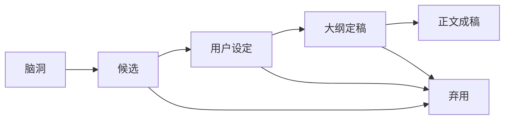

# 文风校准、创作进度与素材附录

> 截止日期：2026-09-12  
> 2026-09-20 局部核对：仅更新可读取的保存稿及索引；原截止日期不代表全量谈话已覆盖，本次也未推进全项目覆盖日期。详见第九节第五项。
> 2026-09-28 局部核对：补齐可回查稿件、访谈与导出文件的索引，记录旧版本差异；仍未取得可回查聊天全文。最新覆盖清单见第九节第六项，原截止日期不作为全量完成日期。
> 2026-10-11 增量核对：同步 10 月 6—7 日已提交的《随你喜欢》大纲与心理素材；可核验聊天全文仍为 0 篇。实际范围见第九节第八项。
> 2026-10-19 增量核对：补齐第30—32卷的现行资料入口、10月15日重伤长谈与10月18日第一人称全篇的状态和版本记录；本轮可核验聊天全文为0篇，原照片未重新核验。实际范围、基线与缺口见第九节第九项。
> 2026-10-25 增量核对：补齐第33卷确认转录入口、《随你喜欢》第一人称稿10月19—25日修订链，以及04册与《神降》后续正文的版本差异；本轮可核验聊天全文仍为0篇，原照片未重新核验。实际范围、基线与缺口见第九节第十项。
> 用法：每次续写前先看“人物声音速查”和“弃用表达”；考据时看“待核资料”；找旧稿时看“现有素材”。
> 人物与文本判断见《磕_谈话总集_01_杀铃关系研究与人物理解.md》；情节设定与长线年表见《磕_谈话总集_02_二创世界观与长线创作圣经.md》。

## 一、人物声音速查

### 杀生丸

一句话校准：**他不是不会说，而是不肯说没有作用的话；真正重要时，他常用一句事实代替情话。**

| 维度 | 应保留 | 应避免 |
| --- | --- | --- |
| 语言长度 | 简短、完整、能改变场面 | 为了“高冷”只吐单字，或突然发表长篇爱情演说 |
| 认知状态 | 对力量熟，对人类制度与异性欲望可以真不熟 | 永远全知、永远先看穿铃 |
| 情绪表达 | 决定先于命名；用等待、回来、记住伤口表达 | 霸总命令、占有宣言、现代撩人话术 |
| 调情方式 | 只在关键瞬间点破一个准确现状 | 把每个动作都复述一遍，变成低配语言挑逗 |
| 好奇心 | 可以发问、观察、想知道 | 把话少误写成没有好奇、没有日常判断 |
| 犬妖感 | 嗅觉、白毛、爪、舔舐、护住痕迹 | 逢亲密必失控、只剩兽性标签 |

适合作为声音坐标的句子：

- “这是我的道路。”
- “没有改变的必要。”
- “你不在。”
- “不是那里。”
- “是我留下的。”
- “不必。”

其中后四句已出现在保存的《第二夜_最终版.md》中。前两句是偏好的语感，不要求原封不动塞进情节。

“蠢话”是树与百年承诺场景里目前较接近他的候选回应：它像驳斥，不像宣誓；但仍需由前后动作决定是否成立。

他在铃面前最常见的口头动作可以归成三类：叫“铃”；回答她刚问的事；在她慌乱时告诉她此刻能做什么。直接而沉重的爱欲判断可以放在读者可见的内心，或放进只有铃读得懂的编码表达，不能因为读者知道，就让铃也像听见了一样回应。

如果一句重话确实要说出口，它必须与当下的选择或行动有关，说完即止。不要再补原因，不要让旁白紧跟着解释“这句话对他们意味着什么”。

他已经知道铃对自己的意义，却未必会把这种感情概括成“喜欢”或“爱”。较强的完整判断优先留在读者可见的内心；台词继续使用决定、拒绝、事实和行动指引。不能把内心独白改写成铃听得见的话，再让她接着回答。

早期杀生丸带有贵族少年／纨绔子弟式的好奇、争强和一点浪荡。婚后偶尔用爪尖勾袖、装作没听见或故意回避一个尴尬问题，可以恢复这部分活性；不必一写放松便把他磨成温润体贴的固定类型。

他与铃说话较少，常因两人已经能从动作读懂彼此；面对孩子或尚未掌握某件事的人，则可以直接说“自己来”一类短指令。不要把“寡言”写成对所有对象使用完全相同的单字反应，台词应服务于当场真实存在的信息差。

广播剧语气要同时留住他的骄傲、私欲与不施压。“それまで己を大事にせよ”不写成游刃有余的撩拨，也不写成彻底退让；他可以理直气壮地希望铃选择自己，只是不要求铃为了满足这份希望而改变生活。

### 铃

一句话校准：**她靠体验和直感抵达关键处，不靠成熟的心理术语解释关键处。**

| 维度 | 应保留 | 应避免 |
| --- | --- | --- |
| 活性 | 爱问、会笑、会喊、偶尔很虎 | 成年后自动变成端庄安静的贤妻 |
| 洞察 | 一语点中眼前事实 | 每次都替对方总结深层心理 |
| 勇气 | 会怕、会迟疑，但仍向前试 | 没有任何犹豫的完美阳光角色 |
| 欲望 | 可以更主动、好奇、直接调整动作 | 被动承受，或像老师一样“调教”杀生丸 |
| 称呼 | 成年后仍可自然说“杀生丸大人” | 为证明平等而强行改掉全部旧称呼 |
| 身体知识 | 因跟随枫而熟悉月事、接生和伤病 | 一开口便像现代医学科普或关系咨询 |

称呼规则：铃默认说“杀生丸大人”，一般也不改用“你”或“您”。只说“杀生丸”是极少出现的关系转折信号，必须有足够压力和前文积累；出现一次不等于永久改称，之后仍可自然回到“杀生丸大人”。

铃的判断要从具体的人、伤和动作出发。她可以提高声音、重复“他是我的病人”，但不会在医馆冲突里突然使用现代伦理、权利或治疗语言。越激烈的情绪，越要保留她说具体事实的习惯。

铃可以说得很简单：

- “慢一点就好。”
- “这里可以。”
- “铃没有坏掉。”
- “这样就碰不到了。”

这些话的重点是现场可操作，不是替关系下定义。

关系已经安定以后，铃不必反复把自己想成负担，也不必先担心杀生丸会因她提出欲望、工作或不适而嫌弃。她可以理直气壮地继续、停下或改主意；担忧应当来自眼前确实发生的身体问题，而非通用的自卑反应。

## 二、已明确弃用或警惕的表达

| 表达／套路 | 状态 | 为什么不对 | 更合适的方向 |
| --- | --- | --- | --- |
| “既没有躲，也没有遮。” | **[弃用]** | 对称短句有明显生成式文风，动作信息又很空 | 直接写手放在哪里、视线停在哪里 |
| “刚才不是很有胆量……” | **[弃用]** | 通用调情台词，换任何强势男主都成立 | 让他指出当下真正发生的一个变化 |
| “你知道自己在做什么。” | **[弃用]** | 霸总／危险恋人模板 | 写他停下、看她是否继续，或问一个具体问题 |
| “你怎么知道没有。” | **[弃用]** | 故作暧昧，人物辨识度低 | 省掉语言，让动作给出答案 |
| “这是命令吗？” | **[弃用]** | 会把铃写得过于机敏、像在语言博弈 | 让她按直觉理解或直接照做／不照做 |
| “再动，便是不想睡。” | **[弃用]** | 古风霸总调情，不像杀生丸 | 他可敏锐点破真正妨碍睡眠的动作，但不要威胁式撩人 |
| “我不会让它倒。” | **[弃用当前版本]** | 百年守树被说成控制型承诺，太像霸总 | 回应更冷、更短；长期行动留到以后显现 |
| “到时候，我会来。” | **[弃用当前版本]** | 预制深情感过强，像作者替他发金句 | 不提前命名未来；让他届时真的出现 |
| “你问的是树。” | **[弃用当前版本]** | 太聪明、太像故意玩双关 | 他未必解释双关，甚至只驳一句“蠢话” |
| “不会——为什么——因为是你” | **[弃用结构]** | 常见 AI／网文三步情话模板 | 删除原因说明，保留决定本身 |
| “对杀生丸而言……对铃而言……” | **[强烈警惕]** | 场景后补总结，替读者完成感受 | 在最有力的动作或一句话处停笔 |
| 三个短段依次升华 | **[警惕]** | 容易产生工整而空的 AI 节奏 | 合并为有因果的长短句，让段落随动作呼吸 |
| “不是……而是……”式假转折 | **[警惕]** | 常把两个可以并存的意思硬拆成漂亮结论 | 直接写主要判断；确有纠正关系时才使用 |
| “她敢碰，也敢要”式成对短句 | **[弃用节奏]** | 为整齐牺牲人物观察，容易变成宣传口号 | 写她在当场做了什么、为什么继续 |
| “钉成规则”“把意义压进……”等强行隐喻动词 | **[警惕]** | 动词喧宾夺主，使普通说明像刻意炫技 | 使用“写明、保留、形成、影响”等准确动词 |
| 反复用“稳稳、慢慢、克制”概括亲密 | **[警惕]** | 把具体身体差异压成统一的温柔滤镜 | 交代为什么停、怎样改角度、下一动作改变了什么 |
| 通用恋爱反应包 | **[弃用]** | 心跳、屏息、耳热、嘴硬若成套出现，换角色也成立 | 选择与爪、气味、称呼、职业或旧经历有关的反应 |
| 把“是妖怪就好了”扩成“铃如果也是妖怪，就能一直待在……” | **[弃用改写]** | 复刻分镜时擅自替铃解释完整因果，削弱原句留白 | 画面提供了关系时，忠实保留“是妖怪就好了” |
| “那身衣袍也随之覆上身体”“中间已经隔着恢复如初的衣料” | **[弃用说明]** | 隐喻已经让读者明白变化，再明说衣物只会重复提示 | 保留上一版的只言片语，让后文从铃的触感自然揭示 |
| “她低头看了一眼，才把手收回来” | **[弃用动作]** | 多出的视线让原本自然的收手显得像故意占便宜 | 直接写她把手收回来 |
| “我不喜欢她”用于莳萝段落 | **[弃用当前台词]** | 莳萝没有爱上杀生丸，回答“喜欢”会接受错误前提 | 先说“那与我何关”，在纯血子嗣被提出后明确“我拒绝” |
| “现在居然会管这么多闲事了” | **[弃用人物判断]** | 把杀生丸对具体关系的改变误写成普遍热心 | 让神乐只指出确实改变的某一件事，或干脆不概括 |
| “还没跨进门，就喊起了枫姥姥” | **[弃用动作节奏]** | 铃刚回村时过早把注意力甩向屋内，会显得她急于逃离杀生丸，而不是舍不得又愿意留下 | 让她跨门、回头、听见身后动静，或由杀生丸先离开，保留分别的迟滞 |
| 把“无尽夏”写成事件清楚、意义完整的线性小故事 | **[弃用当前方向]** | 会抹掉炎热、嘈杂、似梦非梦和感情将要萌芽的质地 | 让声音、人物行动和热气互相遮挡，结尾只留“下次见”，不解释它为何值得记住 |

## 三、文体总规则

### 1. 先让场景成立，再考虑象征

铃可以象征生命力，但人物当下不会觉得自己在“象征生命力”。写作顺序应是：

1. 她先做了一件只有她会做的具体事。
2. 杀生丸作出反应。
3. 物件、气味、光线和时间产生回响。
4. 到这里能停就停，不急着解释主题。

### 2. 少用空短句，多用连续动作

用户反复不喜欢“一个动作一句、每句单独成段”的 AI 感。短段可以留给真正的停顿，但常态应让动作、感受与判断处在同一条语法流里。

标题和小标题也不要压成缺少主谓关系的电报体。归档可以简洁，正文中的句子仍应完整；不要为了显得利落而连续砍掉连接词、施事者和因果关系。

不理想：

```text
他看着她。

没有说话。

风停了。

他终于明白。
```

更合适的方向：让视线落点、周围物件和下一动作连接起来；不写“终于明白”，让读者从动作变化看见明白发生了。

### 3. 台词不替旁白做解释，旁白也不替台词翻译

如果杀生丸说“你不在”，下一句不必解释“原来没有她的屋子对他而言不能算家”。如果铃说“他连爪子都避开了”，也不必立刻概括“这就是大妖怪的温柔”。让村妇停住的手、读者对爪的认识和后文的浅伤共同完成含义。

### 4. 用反复物件维持长篇连续性

目前最有效的物件／动作母题：

- **发绳：** 夜里散开，清晨扎回；后来由杀生丸放在枕边。
- **灯：** 是否吹灭对应是否允许彼此看清，不只是明暗氛围。
- **白毛：** 身体、被褥、气味载体，也是只有妖怪能实现的浪漫空间。
- **药篮与伤药：** 铃的工作进入婚恋空间，防止宅邸吞掉她的生活。
- **水杯：** 杀生丸不说安慰，却确认水温、递水。
- **接送：** 从青年等在门外，到老年扶她回家，承担几十年时间。
- **巨骨与鬼角：** 把跨时空父爱落成兄弟俩滑稽的体力劳动。

### 5. 留白的停笔测试

一段写完后，逐句检查：

- 这句是否只是解释上一句已经让人看懂的内容？
- 删除“他意识到／她明白／这意味着”以后，场景是否仍成立？
- 最后一段是不是在替读者总结感动？
- 能否停在动作、物件或一句有余味的话上？

只要删除后含义仍在，就优先删除。

“读得清楚”不是所有短篇的最高目标。若场景要留下多年后仍像梦一样的记忆，可以让读者先感到温度、噪声和人物擦肩，再逐渐拼出事件；不要为了交代完整而抹平当时的混乱活力。参考作品只能帮助确定节奏与镜头感，不能把别作意象逐件搬进正文。

### 6. 漫画截图与对白整理规则

项目中的漫画页按日漫版式从右到左、从上到下读取。整理对白时：

- 杀生丸的内心独白用圆括号标出，不能与气泡台词混在一起。
- 邪见等人的心想单独注明说话层级。
- 不收拟声词和动作字；原作称呼原样保留。收录范围依当前原作对白集的阅读说明：较早片段以杀生丸、邪见、铃为主，第21卷保留神乐的完整交易问答，从第23卷起一并保留与三人构成现场问答的其他角色台词，避免拆断对话。
- 复刻分镜时，画面已经承担的因果不补进台词。原句只有“是妖怪就好了”，便不扩写成铃已经解释完整寿命论。
- 中文字数和“对话次数”必须注明所用版本、页码与统计口径；局部摘录不能冒充全作统计。

### 7. 媒介冲突与二创标签

- 默认《犬夜叉》漫画、TV、《夜叉姬》动画与椎名漫画属于同一世界线；出现直接冲突时，本项目优先采用椎名漫画。
- 动画特有能力（例如光鞭）必须注明媒介，不写成漫画文本事实。
- 传闻、作者说法和制作删案没有原始出处时继续标 **[待核]**。
- 用户二创只能标 **[用户设定]**、**[候选]** 或 **[创作定稿]**，不因与原作相容就升级成官方倾向。
- 明确标为 Test、测试或仅用于检验规则的假设，不进入人物结论、故事圣经、弃用项、冲突表或讨论时间线；只有用户后来正式采纳，才另行归档。

## 四、亲密场景的写法校准

### 1. 官能感从人物差异生长

适合反复调用的感官轴：

- 爪尖收起多少。
- 掌心与人的皮肤接触时如何改变角度。
- 白毛根部、毛流与覆盖皮肤的触感。
- 银发、黑发与侧额散开的发束。
- 妖怪嗅到而人类闻不到的气味。
- 新左臂与旧记忆之间的落差。
- 人类身体留下痕迹的速度，以及妖怪记住痕迹的方式。
- 灯下能够看清与林间只能匆匆触碰的差别。

不应只堆“滚烫、颤抖、低喘、占有”等通用词。

### 2. 铃不负责全程安抚

杀生丸停下时，铃可以：

- 看一眼伤处。
- 说疼或不疼。
- 把他的手挪开半寸。
- 抓住肩膀让他慢一点。
- 自己重新靠近。

她不必发表“你已经做得很好”“我知道你害怕伤害我”。后一类话会让她变成咨询师，也让杀生丸的观察力失效。

### 3. 杀生丸可以冲动，但不能失去人物判断

冲动可表现为：

- 呼吸、肩背或手臂力道突然变化。
- 对气味和某个身体部位产生近乎本能的舔舐。
- 在已经确认允许的范围内加深力道。
- 因铃的声音想起她复活后的生命活性。

不必表现为：

- 无视停止信号。
- 用伤害测试她是否爱自己。
- 事后靠长篇忏悔修复本可当场停止的问题。

### 4. 强度与温柔不互相排斥

**[废案注／2026-10-21]** 原句以「第三夜」为例，三夜已作废；改写为：「亲密场面更激烈」与「杀生丸可能是更轻柔的那个」可以同时成立。前者指欲望与决定的强度，后者指他仍能精确避开真正危险。可以留下痕迹，不必制造严重伤害；可以有相互想加深力道的冲动，但每一次继续都建立在对方仍主动参与之上。

### 5. aftercare 仍要像这两个人

优先写：舔痕、闻气味、递水、拉被褥、记住伤处、清理现场、第二天照常接送。少写现代情话、宠溺称呼和情绪复盘会议。

### 6. 身体反馈比技巧说明更有效

当前非插入片段的有效写法是：铃先通过腰腹、膝盖、手指或呼吸产生一次可观察的变化；位置偏开后，她只说“刚才那里”；杀生丸随即回到她指出的位置。不要让铃讲解一套技巧，也不要由旁白宣布两人“找到了正确方式”。

这段保留的是旧讨论的校准示例。“刚才那里”未见于本次读取的《玩具日_番外_主动亲密.md》v9，不能把示例当成现稿已有台词，或为匹配旧索引而回填。

如果视线受水、雾、白毛或角度阻挡，人物发现看不清后应继续回应触感和对方，不要为了替读者说明动作而持续“盯着”。同理，隐喻已经透露衣物或身体变化时，不再追加一层衣料说明。

### 7. 配角保留自己的欲望与知识边界

- 蛾没有人的伴侣伦理，但她不是恶意第三者；耐受药与夺舍诱惑是两件事。
- 神乐重获身体后的第一要务仍是自由。她只能谈自己亲历、或与铃共同见过的旧事，不替作者总结杀生丸婚后的全部变化。
- 凛拔出爆碎牙是保护家人的一次超常发挥，不能借此把她长期改造成擅长太刀的人。
- 莳萝提出繁育看重的是强大血统，不是爱上杀生丸；台词不能沿着“她喜欢你”继续误读。

## 五、现有创作成果与状态

| 项目 | 状态 | 已知位置／备注 |
| --- | --- | --- |
| 两个月关系确认大纲 | **[已全文核对保存稿；原定稿记录保留]** | v4，188 行；来访分界、耳尖动作及三夜旧概括与当前材料存在差异，新分集衔接待回查 |
| 村中探访三阶段 | **[用户设定／稳定]** | 初回村频繁直访；枫提醒后降频；初潮至婚仪由邪见传礼并告知所在地；婚后恢复直接来往 |
| 关系确认正文第一段 | **[旧确认记录／原第三人称稿已核]** | 当前实际文件为 `03_创作稿件/【七千字】随你喜欢`，无扩展名；仍从回忆初见写至铃推开他。v23为迁移前记录，不代表第一人称稿版本 |
| 关系确认正文第二段 | **[原第三人称保存稿／定稿状态待核]** | 与上一项同一文件，6,492字节；未见旧索引的耳尖动作。“第二段第四版”与该稿的对应仍待核，不补回旧动作 |
| 《随你喜欢》第三集及后续 | **[已归档大纲与人工编辑素材／非正文定稿]** | 10月15日已补半年冷却、海战重伤、三五日养伤、寿命长谈、蛟龙赠礼，再接村中难产；重新亲吻不再是恢复关系的必要条件，具体分集仍待定 |
| 《随你喜欢》杀生丸第一人称 | **[已有独立全篇／主线采纳范围待核]** | `03_创作稿件/随你喜欢_杀生丸第一人称.md`，595行、43,768字节；10月18日建立十二节结构，10月19—25日继续精修第二至第六节，已写至晚年与身后。未替换原第三人称稿，差异见02第四节第八项 |
| 第30—33卷对白与分析 | **[确认转录已入库]** | 两份主体文件已有第30卷、31卷85—87页、32卷139及170—173页，以及第33卷两批确认稿；本轮补总集证据入口，未重抄对白，也未重新核验原照片 |
| 《神降：疯长的贪婪》 | **[保存正文／文件自标终稿；长线位置待核]** | `03_创作稿件/神降_疯长的贪婪.md`，100行、7,780字节；10月20日初稿、开篇精简，10月21日追加《信徒的捕神之阵》。04册仍保留较早的“两版待打磨”状态，不能只凭提交标题认定用户已完成最终取舍 |
| ~~访婚第一夜~~ | **[废案｜2026-10-21]** | 三夜整体作废。深谈村居、大宅、半妖孩子与未来的内容可回收为普通长谈，不再标为「第一夜」 |
| ~~访婚第二夜旧稿~~ | **[废案｜2026-10-21]** | 随三夜作废；`/磕/第二夜_2026-08-28_新指令修订版.md` 与 08-25 稿仅作场景素材（力道、界限、白毛、村妇段落） |
| 关系前期正文 | **已保存并持续修订** | `/磕/关系前期.md` 与同名 `.docx`；已写入提前融爪与天亮再生，发现后护理线仍待续写 |
| ~~访婚第三夜~~ | **[废案｜2026-10-21]** | 三夜整体作废。「确认共同生活」的叙事位暂空；身体强度与 aftercare 仍可单独回收 |
| ~~三夜仪式的正式化作用~~ | **[废案｜2026-10-21]** | 三夜形式已废。仍需解决的内核保留：把“随叫随到＝已经在一起”的妖怪默认，转成双方和关系人可辨认的共同生活；礼后喜饼与亲族共食仍是候选，但不再挂靠三夜 |
| **成婚形式的替代方案** | **[待定]** | 用户 2026-10-21 表示「有更好的方案」，尚未给出；不得用三夜或旧两个月大纲自动回填 |
| 树与百年承诺片段 | 未定稿 | “我不会让它倒”等版本已弃用；方向是更冷的回应与后续行动 |
| 牵手／毛茸茸镜头 | 场景方案 | 访谈出处待核，误作“搭手游戏”的结构可继续写 |
| 月事误会 | 场景方案 | 血味误判、铃坦然、妖怪方式缓解疼痛 |
| 铃的医馆 | 世界观已稳定 | 青年开馆缺关键首案；中年“师丈”和老年接送已清楚 |
| 医馆失控事件 | 稳定大纲，未见完整正文 | 毒爪造成二次伤害、两日抢救、无正式道歉；下次改用白毛／尾部固定 |
| 医馆出诊与大宅 | 稳定世界观／场景候选 | 村中为平日日常；大宅用于休养、生产、短住和内殿结界；杀生丸可送铃出急诊 |
| 蛾篇 | **[独立 AU 总纲与前传交接稿已定位]** | v2 总纲内部的五支编号已核；药物知情程度及后段处理与现有总集存在差异，采纳版本仍待回查 |
| 神乐复活 IF | **大纲已收束** | 天生牙出手、半年重塑与“自由”已定；复活真相何时揭开仍开放 |
| 凛养女线 | 稳定危机节点 | 妖猫族孤女、匕首与速度、爆碎牙超常一击；收养起因待补 |
| 非插入亲密旧片段 | **[原记录：修订中；对应稿件待核]** | 旧索引以身体反馈与“刚才那里”推进；未核明与下列 v9 的版本关系，保留两项记录 |
| 主动亲密片段 | **[已保存片段／定稿状态待核]** | 《玩具日_番外_主动亲密.md》v9；现稿有“我想确认一些事”，未见旧索引中的“刚才那里” |
| 玩具日长场景 | **[两份保存正文／成年婚后]** | Part 1 为 v3；Part 2 的列表元数据未给版本号。分卷接续已核；未取得确认消息，不认定整个故事已定稿 |
| 温泉《气味散去以后》 | **[已保存完整正文及交接说明]** | 232 行；医馆气味、早归与温泉互动已成文，独立文件未修改 |
| 莳萝与铃家 | **[已有保存正文]** | v6，179 行；含繁育提议、双子听旧事及百年后墓前来访，不与蛾篇并线 |
| 铃留村的第一次提议 | **[试写／明确未定稿]** | v6，127 行；约十岁、最终战后，铃主动提出留村只属于该二创方案 |
| 青春期之后的六阶段 | **[已保存初稿]** | 47 行；六段分期已并入 02 的初稿索引，年龄与旧年表衔接待核 |
| “无尽夏”村中短篇 | **[候选]** | 炎热嘈杂的午后插曲，以铃说“下次见”结束；当前缺群像行动线和梦幻节奏 |
| 永远应试与现代妇产科 | 世界观／小剧场 | 需补现代执业路径、理玖与女儿具体设定 |
| 食骨井捡妖骸大赛 | 短篇梗成熟 | 可直接写成兄弟喜剧 |
| 喜丧与两百年后 | 长线结局成熟 | 尚未串成连续正文 |
| 项目与文风指令 | **[GitHub当前入口已核]** | 当前读取 `00_入口与规章/磕_项目指令_路标版.md`、`磕_项目规章_杀生丸与铃.md` 与 `文风纠偏指令_自然汉语与角色表达.md`；旧 `/磕/` 及迁移前位置只作历史记录 |
| 世界书与记忆导出稿 | **[文件存在；导入结果未验证]** | Markdown、通用 JSON、RikkaHub lorebook JSON 与记忆初始化稿，见第六节第五项；不作为聊天原文 |

## 六、现有素材索引

### 1. 完整文本

#### 《第二夜_最终版.md》

- 创建及保存日期：2026-08-25。
- 体量：737 行，约 21 KB。
- 版本角色：历史版本；后续判断以 08-28 新指令修订版为准。
- 内容范围：第一夜后的清晨与村妇询问、第二日、傍晚重逢、亮灯下身体探索、浅伤与力道调整、夜深后的照料和气味变化。
- 重要原句索引：`今夜还没有结束`、`他连爪子都避开了`、`那不是穿在身上的，是长在他身上的`、`你不在`、`铃没有坏掉`、`不是那里`、`是我留下的`、`气味变了`、`不必`、`明天，他还会来`。

#### 《第二夜_2026-08-28_新指令修订版.md》

- 旧结构下的第二夜修订版：489 行、约 18.9 KB；2026-08-30 三夜重构后改列 **[弃用／待拆]**。
- 主要修订：增加自然数量的“杀生丸大人”，避免随意使用“你”；把一次裸名“杀生丸”写成关系转折。
- 连续性要求：裸名出现后，默认称呼仍会恢复；不能把这一刻解释成命令服从或固定称谓升级。
- 可继续回收：称呼密度、身体反馈、白毛与气味、停止信号、事后照料；不能直接沿用其“第二夜”的位置与第一次意义。

#### 《关系前期.md》／《关系前期.docx》

- Markdown 当前为 331 行、约 20.4 KB；另有同名 Word 版本。
- 正文已写：第一次完整亲密、爪尖妨碍手指动作、下一次约会前杀生丸以毒融去十根尖爪、铃未察觉、天亮前爪尖重新长出。
- 尚未写入或未在本轮核对到：铃发现后的怒气、她接手修爪、刀刀斋制作耐毒护理工具。这些仍是候选续写。

#### 写作指令文件

- 《全局指令_自然中文与去模板化.md》与《文风纠偏指令_自然汉语与角色表达.md》：全局自然中文、去模板化与留白规则；两份是否需要合并，后续可按实际加载方式判断。
- 《项目指令_杀生丸与铃.md》：人物声音、称呼、表达渠道和重台词使用条件。
- 两者用途不同：前者约束所有中文写作，后者只约束本项目；若发生冲突，先检查具体人物和场景，不把规则机械叠加。
- 2026-09-28历史核对位置为 `/全局指令_自然中文与去模板化.md`、`/项目指令_杀生丸与铃.md` 与 `/磕/文风纠偏指令_自然汉语与角色表达.md`；这不是当前读取入口。当前项目与文风规章在GitHub根目录下的 `00_入口与规章/`，以本册状态表及入口索引为准，本轮没有回查或写回旧存储位置。

#### 两个月关系确认大纲与正文

- 大纲已经归档，内容覆盖关系确认前约两个月的拉扯、来访礼数、双方误读和铃最终主动伸手。
- **原第三人称稿的当前入口已核：** `03_创作稿件/【七千字】随你喜欢`，文件名无扩展名；blob 为 `d794e5fa60615a14c106e797b1076661c9257a9b`，187行、6,492字节，本轮全文读取。迁移前曾以《杀铃_确定伴侣关系前的两个月_正文初稿.md》、v23记载；旧名称和编号只保留为历史线索。此稿从回忆初见、寿命与记忆写至牵手、初吻，结束于铃推开他；内部誓言没有改为对外对白。它与10月18日第一人称稿是不同文件。
- **旧状态不直接沿用：** “第一段已确认、第二段第四版”属于此前记录；本次未取得相应确认消息，不能据文件更新推定全文定稿。现稿未见旧索引所记的耳尖动作，后续不得照索引补回。独立正文中的措辞与重复均保持原状，本次未获正文改稿授权。
- **旧记录保留以供回查：** 第一段曾记为第三人称回想、铃主动伸手与花丛对照，并按分镜只写“是妖怪就好了”；第二段曾记站立亲吻、白毛中半睁眼、身体距离变化与耳尖动作。本次不否定当时的确认，只不把这些描述继续当作当前保存稿的完整说明。
- **大纲已于 2026-09-28 全文读取：** `/磕/杀铃_确定伴侣关系前的两个月_情节大纲.md`，`libfile_3d181b20bbfc81919709be4197bee358`，版本 4，188 行。文件将亲近、成家、居所与生育分别处理，并保存阿离、珊瑚夜话和铃最终伸手的安排。它仍写确认关系后直接来访，另保留耳尖动作与三夜旧概括；差异已在 02 第四节第八项登记，独立大纲未改。文件已读不等于来源对话已补齐。

#### 《随你喜欢》（七千字）第三集及后续

- 当前路径为 `03_创作稿件/【七千字】随你喜欢单集大纲_第三集.md`，截至本轮基线的 blob 为 `768a9cc5f3392ebc94076f1c4a725785f540b97c`，800行、19,680字节，本轮全文读取。10月11日记录的746行版本已被10月15日的归档更新，不再称作当前版本。
- 文件保留2026-09-19收录的第三集内容；`9052232` 于10月6日补入难产及双方动摇，`b62be3a` 于10月15日补入半年冷却、海战重伤、养伤长谈与蛟龙赠礼，并明确这些发生在村中难产之前。
- 第三集原有核心仍是：铃接受亲吻后无法立即处理后续进展，杀生丸把生命延续看成一种可能的回应；铃要求停止，他照做。新增场景让他在目睹生产危险后发现，这种愿望可能使铃付出当下的生命。
- 大纲明确属于铃十八岁以后的关系确认阶段，与成婚形式分开。**[废案注／2026-10-21]** 原写「与访婚第三夜分开」，三夜已作废。约半年冷却、三五日养伤及重伤长谈先于难产已经有入库依据；具体分集、海战起因及其余间隔仍待定。重伤照料、长谈与赠礼已承担恢复来往的功能，重新亲吻是否另写仍为候选；解释性引语不自动成为角色对白。

#### 《随你喜欢》（七千字）素材

- 当前路径为 `03_创作稿件/【七千字】随你喜欢_素材.md`，截至本轮基线的 blob 为 `e56ba8559aa0144df4d5cc25c0a52a9f6f8f9277`，239行、16,156字节，本轮全文读取。此前77行版本不再作为现稿。
- `9052232` 保存10月6日场景口述；`d0cd2ec` 补入10月7日“血味”违和感；`b62be3a` 于10月15日补入重伤照料、用户人工编辑的长谈与伤愈赠礼。人工编辑稿保存了当时的感觉和谈话方向，仍未作为正式正文合入原第三人称稿。
- 铃过去满身是血时仍被杀生丸抱起，因此不会把他的反应简单理解成怕血或嫌弃气味；她能先安抚眼前的人，却尚不知道他已把难产风险与自己联系起来。口述中的“你又不是……”只说明心理，不直接作为正式台词。
- 本文件是大纲与心理描写素材，不是新增正文。具体问不问出口、场景如何收尾及后续怎样处理生育迟疑，继续留给正文。

#### 《随你喜欢》杀生丸第一人称全篇

- 当前路径为 `03_创作稿件/随你喜欢_杀生丸第一人称.md`，本轮写入前 blob 为 `e7286119304ea1875eaf943a49d37b5b5031fef8`，595行、43,768字节。首次保存为10月18日提交 `a9a0f29`；十二节结构由同日 `4ede6bf` 完成。当前稿全文取得，新增段落及与上轮基线的完整差异已核。
- 已写范围从冥道往事与村中来往，经成年关系、半年冷却、重伤长谈和生育，延伸到衰老、临终及两百年后。状态为“已有独立全篇”，不再误记为尚无后续正文；主线采纳范围和全文定稿仍缺对应确认原文。
- 修订顺序：`a9a0f29` 首次归档 → `449cb3a` 口语回溯尝试 → `e24dc86` 撤销该次改写 → `46e61b0` 调整开篇 → `3cdb6ec` 增加大名与女妖插曲 → `e3bae94` 调整成年初次推进场景 → `d211815` 调整第一人称视角与反应 → `47f87dc` 调整寿命独白 → `4ede6bf` 划分十二节。以上均已核对提交元数据与目标路径；正文全文核读对象为当前保存稿，不将每个历史版本都计为全文核读。
- 10月19—25的新增修订链：`a25a418` 理顺第四节的寿命触发与父系逻辑 → `b52aea6` 扩写初吻的自主亲近 → `9b2fe94` 收束第一人称并改写铃被吓退的动作因果 → `70e44a2` 扩写半年冷却 → `fc2753c` 增加锚点与寂寞判断 → `9b54863` 补初潮红豆饭和夜赠铃兰 → `065ae26`、`f67b221` 收敛犬夜叉反应 → `3eec84c` 精简养伤长谈结尾 → `38e101b` 补海战后的私心独白并继续精炼对白。
- `e24dc86` 只证明 `449cb3a` 对本文件的改写已被回滚，不证明作者改变了全项目文风偏好。后续十笔提交已经继续改稿；每笔只能说明该正文版本发生了什么，不能单独充当整个项目的文风指令。
- 版本差异和后续待办统一见02第四节第八项的第一人称稿表；除原有的关系重启、报喜细节和正文特有身体规则外，现又需核对初潮红豆饭与铃兰、重伤时哈气强度，以及长谈中被删除的呼唤／等待问答。原稿保留，本轮不替用户选择取舍，不把新稿独白写成原作对白或共同人物结论。

#### 《神降：疯长的贪婪》与谈话总集04

- 当前正文位于 `03_创作稿件/神降_疯长的贪婪.md`，本轮写入前 blob 为 `587af85b81881a8d16eada1af1003c781db1d9fa`，100行、7,780字节。`3cd8110` 于10月20日保存初版，`511fc05` 精简开篇；`6da7606` 于10月21日追加《续章：信徒的捕神之阵》，文件标题现自标“终稿”。
- `01_核心总集/磕_谈话总集_04_低配得感与神降_跨维度宗教感.md` 的当前 blob 为 `99f111e7604d3c6697c4bcdf62da153a5645acb7`，256行、16,253字节，保存了10月20—21日的用户原话、共同解读、正文初版与润色版差异。该册生成早于 `6da7606`，仍写“两版并存、待打磨”，因此状态晚于它的正文提交尚未同步回04册。
- 本轮按04册把“低配得感”“索求只尝试一次”“不适而非后怕”、犬妖对妖气／气味回馈的偏好及跨维度宗教感分别归入01、02、03。它们是项目设定与共同解读，不是原作事实；“神明／信徒”是关系比喻，不建立字面神格。
- 正文是否已经得到用户最终确认、续章是否与“只尝试一次”属于同一场，以及它在关系时间轴上的位置，仍缺可回查的完整谈话。正文与04册均未在本轮改写。

#### 蛾篇整理稿

- **位置已核：** `/磕/异色梗_蛾篇双前传与五种结局.md` v2，191 行；`/磕/蛾篇前传一_补药_Gork交接大纲.md`，162 行。两份均全文读取，取代旧索引“未定位独立文件”的状态。
- 总纲明确是两段独立前传加五种互斥结局的番外／AU；第三支与第五支的分裂不同，只有第四支采用男性蛾。文件内部编号已在 02 第十四节对齐，未将任何结局并入主线。
- 前传交接稿对铃服药时知情程度、杀生丸是否识破以及药丸用途的写法，与本册、02 的部分旧记录不一致。未取得确认或撤回原话，保留待核，不依据更新时间自行选定。

#### 此前漏列的独立稿件

以下登记文件中实际存在的正文及其自标状态；本轮仍未取得对应的用户定稿确认。

| 文件（均在 `/磕/`） | 已读范围及用途 | 使用限制 |
| --- | --- | --- |
| 《铃留村_第一次提议_试写.md》v6 | 127 行全文；铃在最终战后首次提出留村，保留她与邪见、杀生丸的当场反应 | 页首明确未定稿；不能据此认定原作由谁先提出留村 |
| 《温泉_气味散去以后_完整稿与交接说明.md》 | 232 行全文；正文与交接说明合存，医馆工作与温泉相处已有完整篇幅 | 明确成年婚后；工具修爪已用于该稿，不代表制工具过程已另有正文 |
| 《玩具日_杀铃长场景_part1.md》v3、Part 2 | 分别为 87、129 行，均全文读取；两份开头、末尾能顺序接续 | 不凭旧助手声称合并稿存在就认定另一版本已保存；本次未定位其合并稿，分卷原文未改 |
| 《玩具日_番外_主动亲密.md》v9 | 83 行全文；已保存的独立后续片段 | 不把旧讨论示例“刚才那里”补回本稿，不自动认定与其他片段是同一修订链 |
| 《莳萝与铃家_完整故事.md》v6 | 179 行全文；正文标题《莳萝很好，不是吗？》，含成年子女与墓前后日谈 | 与蛾妖为不同人物；只确认这些场景已成文，未重新判定全部主线采纳状态 |
| 《在那以后_青春期之后的六段梗概_初稿.md》 | 47 行全文；恋爱、新婚、夜叉姬、蜜月、磨合、与孩子共同规划未来六段 | 明确是初稿；沉睡情节的媒介取舍及未满四十岁与旧年表的对应尚待核对 |

### 2. 原作对白资料

#### 《犬夜叉首次打风之伤全过程杀生丸台词》

实际文件名为 `/磕/犬夜叉首次打风之伤全过程杀生丸屙台词.md`，`libfile_09845e1549488191b1dbef099f465cb3`。本轮全文读到 13 行，与指定原作对白集第一节逐句对应，无新增，不重抄。

摘录包括：

- “你还不想为我杀生丸打造刀具吗？”
- “你想知道吗，邪见？”
- “天生牙，是杀不了人的刀。”
- “放心，今天一定可以结束的。”
- “因为你根本还不懂风之伤。”
- “那当然！要读出那个，一点儿都不困难。”
- “你这家伙……和我，本来能力就不同。”

用途：观察早期杀生丸的发问、解释、判断和挑衅，反驳“他从来就是只能说几个字”的二创惯性。正式引用时仍需补集数、字幕版本与日文原句。

#### 《犬夜叉》单行本第 16 卷对白摘录

- **[旧摘录已废弃／2026-09-28 核查文件现状]** 《犬夜叉原作对白_杀生丸_邪见_铃_第16卷_页157-165.md》页首已明确废弃，理由是说话人及内心／外部对白标记有误。它仍可作为历史文件定位，不能拿来覆盖现行原作对白集。
- 旧稿最初于 2026-09-02 根据项目内上传截图整理第 157—161、164—165 页；其后指向的《台词设计与人物分析物料.md》也已改成入口，实际正文已拆为用户指定的原作对白集与对白分析两册。
- 阅读顺序：从右到左、从上到下。
- 标注：杀生丸内心使用圆括号；邪见心想单独说明；不收拟声、动作字和其他人物台词；保留原有称呼。
- 用户据此提出“杀铃直接对话不超过十句、杀生丸对铃不足五十个中文字”的统计。页数之外是否仍有遗漏、具体中文版和计数方法尚待核。
- 本次现行对白集与废弃稿比较，至少可见第157页“是犬夜叉”的说话人、第158页外部对白标记、第160页“您要带那个走呀”的归属已不同。统计若继续使用，必须从现行版本重新计算，不能沿用废弃稿的标签。
- 项目谈话曾要求 Markdown 同步到 Library 与项目 Sources；本轮没有项目 Sources 编辑接口，是否两端都已经成功同步仍 **[待核]**。

#### 《杀生丸前期对白_杀邪铃互动_原作对白集.md》

- **[创作定稿／资料整理]** 2026-09-07 用户提供修订版，并确认在此版本上继续归档。
- 项目中先要求把《犬夜叉（21卷）片段对白整理.txt》并入对白整理文件，随后又要求合并第 24 卷两页与后续毒战截图。
- 已确认的纠错包括：七人队毒使名为“雾骨”；杀生丸台词应整理为“对付我杀生丸用对付人类的毒，怎么会有用呢？”；“毒！”由阿篱说；“喂……”由犬夜叉说，不能误算进杀生丸对白。
- 此前归档记录称，截图中括号标出的说话人猜测已由用户逐项确认；保留这项记录，本轮未重读对应确认消息。
- 2026-09-28 核对的指定原文件为 `libfile_0541452b080c819187eac60ae94d91fe` v19，位于当时的 `/磕/`；其目录已含第16、17、19、21、23—27卷片段及《夜叉姬》第十五章。第21卷独立文字转录全文与本文件第六节相符，当时未发现需重抄的新句。
- **[2026-10-04 更新]** 当前 GitHub 主体版已补入第29卷第45—54、57—59页，并在配套分析册增加相应的信息渠道和因果校准；第55—56页缺失，未补写。
- **[2026-10-25 索引核对]** 现行对白集第十三至十六节已收录第30—33卷，对白分析同号章节也已存在。第30—32卷沿用上轮核过的仓库版本；第33卷为本轮新纳入总集索引的已确认转录。读取的是仓库确认稿，没有重新取得这些照片，不能报告为逐张重核成功。

| 入库日期与提交 | 已保存范围 | 本轮引用及保留的缺口 |
| --- | --- | --- |
| 2026-10-12，`6a304595a320857404e0e64f0f33658d84a61a72` | 第30卷第128—129、150—155、159页及末张局部照片，共10张照片的确认转录 | 第152页“就是这么回事。”归杀生丸，第154页“哎？”归甘太；第151、152页按相邻页推定，末张不定页码。第130—149、156—158页与裁切残句仍缺；01只引用寡言观察及救助触发的渠道边界 |
| 2026-10-14，`1f741c12f2275c8e4e767e40d9c73efbe7952d5e` | 第31卷第85—87页，三张照片的确认转录 | 铃、邪见看家与神乐来访；杀生丸未出场，不补其言行。前后页未提供 |
| 2026-10-15，`74835b200543b82ea29a69a9916ad4e41009a4bc` | 第32卷第139、170—173页，五张照片的确认转录 | 第170、171页按与172页的连续关系推定；第140—169页及其他前后页仍缺，173页下半另一场景未收入。感官判断、神乐内心与公开问路分别处理 |
| 2026-10-19至20，`08548c5`、`c9cab87`、`05659da` | 第33卷两批共18张照片的确认转录；首批为第58—62、67、69—72页，补录为第73、74、90、91、105、124页及两张页码未入镜照片 | 四处首批归属与两处补录说话人均经用户确认；推定页码、未入镜页码、缺页及日文／其他中文译本限制继续保留。01只引用公开问答、天生牙内部判断与战斗长句的渠道边界 |

- 四批资料的日文原页与其他中文译本仍未核；新的总集引用不会消除转录本身的限制。两份对白主体文件本轮均保持原状。
- 第24—27卷的现有收录范围可由原文件目录和缺口表定位；本次没有重新取得并逐张校验全部照片，不能认定所有截图已入档或缺页已补齐。根目录同名旧副本未修改；项目 Sources 同步仍未验证。

#### 《第29卷扫描结果.pdf》

- 当前位置：`05_素材附件/10_扫描PDF/第29卷扫描结果.pdf`；Git blob SHA 为 `d216d515e98ef3c7949e949b8109abd3e95a0860`，文件大小 12,699,653 字节。
- 2026-10-04 已逐页渲染并核读全部13页。扫描对应天美版第29卷第45—54、57—59页；第45、47、49、51、54页按相邻页连续关系推定，第55—56页未提供。
- 可确认内容已并入主体对白集和对白分析：奈落以新身体迎战杀生丸、杀生丸对奈落目的的内部判断、桔梗死讯，以及犬夜叉关于“见死不救”的质问。
- 当前只有天美版中文扫描；日文原页和其他中文译本未核。缺页和没有气泡尾的文字均按原样标注，不凭剧情补写。

#### 广播剧《后天》项目摘录

- **[衍生资料／全文待核]** 当前取得片段：`里の暮らしには慣れたか……それまで己を大事にせよ。`
- 当前解读重点是“承诺与祝福”，不把 `よい` 写成游刃有余的恋爱话术。完整台本、音频位置、前后句及译法仍需核对。

### 3. 本轮图片

#### 铃的黑桃 3 扑克牌插画

- 画面：白底，薄荷绿色团花；铃穿红白棋盘格和服、绿色腰带，赤足抬腿、张臂起舞；牌面标注 `Rin` 与黑桃 3。
- 可用方向：作为铃“活泼、无功利、身体先于意义行动”的视觉提示。
- 注意：来源画集／商品信息尚未核定，不把图案设计直接当成剧情证据。

#### 动画截图

- 画面：夜间林地，铃穿粉红衣从前景走过，杀生丸倚在后方的白毛中看向她。
- 可用方向：观察早期同行中的空间距离、视线与铃在场时杀生丸相对放松的姿态。
- 注意：单帧不能独立证明人物心理；需要回到完整集数与前后镜头。

#### 《犬夜叉》与《夜叉姬》漫画截图组

- 第 16 卷截图组已经用于对白摘录，覆盖第 157—161、164—165 页。
- 《夜叉姬》截图组用于关系确认大纲与开篇改写，其中“想多陪你一天也好”“好久不见。铃”及铃关于“是妖怪就好了”的画面均需保留说话层级和前后分镜。
- 截图可以支持画面事实与对白观察，不能单独证明“谁先求爱”、作者意图或角色完整人生安排。
- 页码、单行本版本和译文来源仍需在独立资料中补齐。

### 4. 已保存的衍生访谈

- 《菱田正和_夜叉姬弐之章访谈_日文原文与中文全译.md》：112 行全文已读，来源信息标为用户上传 MHT 提取，保存日文与中文。原报道日期为 2021-10-23，链接为 [MANTANWEB](https://mantan-web.jp/article/20211022dog00m200082000c.html)。与本项目相关的是杀生丸父亲形象及配音收敛的制作说法；分级及限制已并入 01 第九节第五项。
- 《夜叉姬指南书声优访谈_英文全文与中文全译.md》v1：579 行中英文与校注均已读。文件底本是用户上传的 [Furinkan 英文页面](https://www.furinkan.com/features/interviews/yashahimeguide03.html)存档；中文来自英译转译，日文指南书原页没有随本次取得。文件标出的 108—111 页属于访谈合集的出处，不能自动当作每个答案的精确页码。
- 成田段“生物学过程”的英文句已定位；关系类别、部分代词及省略宾语仍需日文核对。长的已读访谈没有补出“铃怎么可以对杀生丸做这种事”的出处，本轮没有把这条检索／可见上下文线索补成原话。
- 本轮读取保存文件，未重新核验外部网页、MHT 底本及日文书页。文件有正文不等于所有转译疑点已经解决；以上内容不写入原作对白集。

### 5. 世界书与记忆导出文件

| 已保存文件（均在 `/磕/`） | 本次检查 | 当前状态 |
| --- | --- | --- |
| 《杀铃_提示词注入世界书_20260922.md》 | 读取第1—54行的用途、资料范围与使用限制 | 提示词用整理稿，只建立索引，未据其摘要新增设定 |
| 《杀铃_提示词注入世界书_20260922.json》 | 全文件 JSON 解析成功，主 `entries` 数组为 37 条 | 语法可解析；未逐条核对内容，也未验证目标应用导入 |
| 《杀铃_提示词注入世界书_RikkaHub_lorebook_20260922.json》 | 全文件 JSON 解析成功，顶层 `type` 为 `lorebook` | 独立的 RikkaHub 导出文件；不把语法检查写成导入成功 |
| 《杀铃_RikkaHub记忆初始化稿_20260923.md》 | 读取第1—31、176—209行的用途、24条核心记忆说明与来源限制 | 可复制记忆草稿，不是原生导入文件；未执行应用内记忆写入 |

这四份文件的现有元数据均显示北京时间 2026-09-24 最后修改，正文标注日期仍分别是 09-22、09-23。初始化稿说明曾使用截止日期较早的附件，并参考讨论整理；它们不能替代当前五份原文件或逐字聊天导出。近期“四项最小修正”的检索命中仍只有摘要，不能凭导出稿倒推用户逐条确认了什么。若以后要同步导出版本，应先取得原话并单独核对；本轮未改这四份文件。

## 七、考据任务清单

### 优先级 A：会直接改变人物或时间线

1. 《半妖的夜叉姬》漫画第 15 话原页与相关作者表述：谁先提出关系、肢体接触如何发生。
2. 广播剧《后天》完整台本及音频位置：绕口令、传话场景、广播剧后到确认前的互动，并核对 `よい`、`それまで`、`己を大事にせよ` 的语气和译法。
3. 铃与杀生丸从原作到衍生的全量互动表，附卷、话、集数和媒介层级。
4. 铃年龄与夜叉姬出生时间的官方依据，区分动画、漫画与访谈口径。
5. 《夜叉姬》漫画中铃推进关系、持枪协同攻击、拜见杀生丸母亲以及杀生丸报告行程的原页。
6. 第 16 卷对白摘录是否已经覆盖杀铃全部直接互动；核对“少于十句／不足五十字”的版本与计数口径。
7. 《夜叉姬》漫画“想多陪你一天也好”“好久不见。铃”的准确页码、气泡／内心层级与前后分镜。
8. 现行GitHub对白集已含第21卷及第24—27、29—32卷片段；继续补原页和缺页。迁移前v19不是当前版本，已废弃的第16卷摘录不恢复；所有照片是否一一入库仍待核。
9. 取得旧两个月大纲、第三集及六阶段初稿的确认／修改原文，核对来访分界、耳尖动作、分集和年龄口径；保留蛾篇药物前传两份记录的差异。10月15日半年冷却和重伤长谈已有可核验入库材料，未解决的是旧大纲如何衔接，不将全部内容重新降为无依据。
10. 取得10月18日第一人称稿与主线取舍的对应消息，按02差异表确认三夜、问答位置、重启谈话和难产细节；在此以前，保存稿只登记实际已写范围，不自动覆盖现行设定。

### 优先级 B：会改变场景细节

1. 杀生丸联名香水的品牌、款名与正式香调表，核对皂感来源。
2. “牵手后毛茸茸桃色镜头”缘由的访谈出处与原话。
3. 成田剑“生物学过程”的英译问答已定位于指南书访谈保存稿；继续取得日文原页，核对关系指代与省略部分。该段没有铃的具体怀胎年龄，年龄说法仍须另找来源。
4. **[废案／已取消]** ~~访婚连续三夜的历史资料：目标时代、地区、身份阶层是否适用。~~ 三夜已于 2026-10-21 整体作废，不必再考据；替代方案若涉及历史婚俗，再另立条目。
5. 铃服装与可能家族／身份的服饰史依据，避免从设计直接推贵族身世。
6. 电视版刹那刻字竹片的制作者与字迹；“大宅与铃感到寂寞”的对应原页，以及作者谈探视频率的准确出处。椎名个人房屋构想与本项目居住私设分别记载，不合称漫画官方安排。
7. “高桥留美子否决杀生丸化作巨犬从火场救人”传闻的原始采访、脚本或制作记录。
8. 光鞭首次出现的 TV 集数、能力边界，以及与漫画设定是否存在直接冲突。
9. **[废案注／2026-10-21]** 原「三夜礼成后送喜饼、亲族会面与共席饮食」的时代依据。三夜已作废，但「礼成后送喜饼、亲族会面、共席饮食」本身仍是有效候选，只需改为挂在新的成婚形式下考据。

### 优先级 C：丰富旁支

1. 战国时期接生、草药、产后出血与跨族群医疗可用的历史素材。
2. 现代日本妇产科医生执业与考试路径，供永远线使用。
3. 两百年跨度中边境家族可能经历的战争与迁徙，供后代线使用。
4. 犬妖源自远古狼与人混合的私人设定，怎样与原作族群、犬大将家系及半妖概念兼容。
5. 神乐遗留肉体、天生牙复活条件与半年重塑躯体之间的规则兼容。
6. 五月作为原作孤女、七宝对她有好感的准确出典；若“无尽夏”短篇继续写，再拆解用户指定的《数码宝贝大冒险》第 21 集视听节奏，但不直接搬用意象。

## 八、对插件与技能检索的结论

### 1. 不需要为了这次归档另装插件

以下为旧轮次的能力判断，不能作为已读取聊天的证据。2026-09-20 曾遇历史检索不可用；2026-09-28 已能取得检索摘要和文件定位线索，但两次查询都没有返回可回查的对话／消息 ID 或逐字消息，仍未证明能够枚举项目聊天及回读全文。文件读取可用。原列举的两类需求仍为：

- **项目内谈话与项目资料**：只从“磕”项目里取回新增讨论，不借项目外历史补缺；无法确认的原句直接标待核。
- **持久文本保存**：可把总览、设定集和后续修订持续保存，形成版本化档案。

当前推荐插件列表中没有一个专门负责“读取整个 ChatGPT 项目逐字聊天并自动生成知识库”。Airtable 或其他数据库型工具即使未来接入，最多改善卡片管理，并不能凭空取得没有开放的完整历史。

### 2. RedSkill 商店检索结果

本轮实际搜索：

- `对话总结`：无匹配。
- `对话归档`：无匹配。
- `知识库整理`：找到 `story16`，版本 1.0.0，作者“石榴还在写小说”。

`story16` 面向短篇作者，把本地 Markdown／TXT、对标文、灵感、课程、旧稿和反馈拆成可检索素材卡，可与 Obsidian 等知识库配合。它适合未来把大量稿件进一步卡片化，但并不专门读取 ChatGPT 历史，也比当前需求更偏“短篇素材库”。因此本轮**没有安装**。

### 3. 迁移前技能分工与当前存储状态

| 技能／位置 | 对本项目的用途 | 当前状态 |
| --- | --- | --- |
| `openai-library` | 迁移前曾用于保存和版本化 Markdown 档案 | 只作为历史备份，不再写回 |
| GitHub `laippmiles/ke-project` | 保存正式静态资料、提交历史和可回滚版本 | 唯一日常维护源 |
| `humanizer-zh` | 清除成稿中的 AI 腔、宣传腔、过度总结与排比 | 适合改稿，不负责历史检索 |
| `writing-dna-skill` | 从至少 20 篇完整文章蒸馏长期写作 DNA | 适合以后建立稳定作者风格，不适合拿零散聊天直接代替原文样本 |
| `story16`（未安装） | 将杂乱小说素材拆成卡片库 | 以后素材规模更大时可考虑，目前非必需 |

2026-10-03 起，本项目继续维护轻量 Markdown 总集，但保存和回滚统一由 GitHub commit 完成。旧轮次关于 Library 写回的判断只保留为历史，不再指导当前操作。

## 九、版本维护规则

### 1. 哪些内容值得入档

- 新形成且能复用的人物判断。
- 一个场景从候选变成定稿，或定稿被推翻。
- 新增世界观规则、时间点或关系节点。
- 明确被嫌弃的台词／文风套路。
- 找到可核验的原作页、访谈或商品资料。
- 明确改变当前稿件版本、媒介优先级或连续性的项目决定。

纯粹重复、即兴笑声或已经被后文完全覆盖的中间句，不必全部收入。

明确标为 Test、测试、临时测试项，或只为检验判断标准而提出的假设，不进入总集，也不作为弃用或冲突保留。只有用户后来明确采纳，才从采纳时点起归档。

### 2. 状态迁移



原作相关内容另走一条线：`待核 → 已核来源 → 文本事实／衍生资料 → 共同解读`。不要让“很喜欢”直接跳成“文本事实”。

### 3. 建议的更新频率

- 每次完成一个明显主题后，追加一条增量记录。
- 每累计 5～10 条新记录，重新整理一次主章节，避免索引越长越难用。
- 每次改写《第二夜》等成稿，都保留版本日期与修改原因，不用“最终版”覆盖所有历史判断。

### 4. 每次更新后的报告

每次自动或手动更新结束，都要附一份可审阅的变更说明，至少包括：

- 本次覆盖的对话日期和实际检查过的来源。
- 每个被修改文件的名称，以及逐条新增、改写或状态迁移。
- 哪些内容没有收录及原因，例如重复、证据不足、与项目无关或应留在私密附录。
- 新增的待核项、互相冲突的版本和保存失败项。
- 如果没有实质新增，也要说明检查过什么、为什么没有改文件。

报告要区分“文件内容发生变化”和“文件被加入项目 Sources”。不能只说“已更新”或只列文件名。

### 5. 2026-09-20 局部核对与覆盖记录

**范围结论：没有取得可独立回查的项目聊天全文，聊天覆盖不完整，也无法计算覆盖比例。** 本次历史检索返回“Personal context is unavailable for this conversation”。当前上下文的记忆和近期谈话摘录仅作线索，不作为原文归档依据；没有据此新增设定、补写对白或认定用户确认。

| 实际读取对象 | 标识与基线 | 读取范围 | 本次处理 |
| --- | --- | --- | --- |
| 01 人物理解 | `libfile_7cfe5d47ddd881918e143402a63f9177`，v4，修改于 09-13 | 1—40、360—405 行；非全文 | 核对用途和开放问题，未修改 |
| 02 写作圣经 | `libfile_7dea1857e6548191a546362908e30e0b`，v28，修改于 09-19 | 文件全文取得；重点核对关系确认、连续性、资料区分和出文自检章节 | 合并保存稿进度和第三集大纲；不宣称全部旧条目复核完成 |
| 03 本册 | `libfile_f3e0fc1f74c48191a1c32329d2c55ca8`，v3，修改于 09-13 | 1—496 行全文 | 更新状态表、素材索引、能力限制与本记录 |
| 指定原作对白集 | `libfile_0541452b080c819187eac60ae94d91fe`，v19，修改于 09-16 | 1—40、2020—2111 行；非全文 | 确认 backing file 为 `file_0000000044e081fda90619f27f527518`；未修改，根目录旧副本未动 |
| 对白分析与二创校准 | `libfile_056b5890bf8c819180bf0b70ba05db91`，v17，修改于 09-16 | 1—40、405—455 行；非全文 | 核对用途、信息渠道与检查要求，未修改 |
| 关系确认正文 | `libfile_921d4851358c8191854e60657abf796d`，v23，修改于 09-19 | 1—187 行全文 | 仅登记保存稿内容和版本，未改独立正文 |
| 第三集大纲 | `libfile_b522a56db1d88191b2df713df1bc7697`，v2，修改于 09-20 | 1—694 行全文 | 提取认知错位、寿命触发、排除写法和衔接待办；未改独立大纲 |

**对话检查清单：本次能够核验全文的对话为 0 篇。** 未获得对话或消息 ID、项目成员清单及逐条消息读取范围，不能把上表的文件读取冒充对话覆盖。检索也未提供可用的项目原始对话导出。检索命中的《磕_项目全量记忆包_2026-09-19.md》未用作原文证据；名称中的“全量”不证明覆盖完整。两个月旧大纲仅定位，尚未通读，也未标为处理完成。

需要继续取得的材料是“磕”项目对话导出：保留项目归属、日期、标题、用户与助手角色、完整消息及可用标识；涉及截图的谈话还需对应原图或已确认逐字转录。应包含较早聊天以及同一聊天后来追加的消息，不能仅提供近七天摘要。收到后才能回查旧大纲与新分集、用户确认及撤回，并核对全部历史遗漏。

本轮实质变更限于 02、03；保存是否成功以实际写入结果及本任务报告为准，不以本记录的形成时间替代保存确认。01、原作对白集、对白分析及独立小说正文均保持原状。未执行或验证项目 Sources 刷新。

### 6. 2026-09-28 局部归档与覆盖记录

**实际聊天全文覆盖仍为 0 篇；无法计算全项目覆盖比例。** 本轮两次历史检索返回摘要与文件线索，没有提供能回读逐字消息的对话／消息 ID，也没有项目聊天的完整成员清单。摘要没有用来补写人物设定、用户确认或对白。文件目录、命中的条目数和当前执行日期均不代表聊天已完整覆盖。

本轮列完 `/磕/` 文件夹返回的 45 个条目，并定位根目录的三份总集与两份写作指令。文件夹清单只证明这些文件可访问，不证明它等于 ChatGPT 项目的全部 Sources 或聊天成员。对更早保存稿的检查从 8 月材料开始，没有只截取最近七天。

#### 五份目标文件的读取与变更范围

以下版本为本轮读取基线，行号也按修改前文件计算。

| 目标 | 身份与基线版本 | 实际读取范围 | 变更范围 |
| --- | --- | --- | --- |
| 01 人物理解 | `libfile_7cfe5d47ddd881918e143402a63f9177`，v4 | 1—405 行全文 | 限定长期觉悟与初吻阶段；更新旧正文版本说明；纠正住所资料分级；补入访谈来源边界 |
| 02 写作圣经 | `libfile_7dea1857e6548191a546362908e30e0b`，v29 | 1—180、197—243、444—457、543—586、799—820、906—1034 行；另检索目录及莳萝条目。未逐条重读全文 | 合并旧大纲差异、成年支线保存状态、蛾篇文件内编号和六阶段初稿；保留未决版本 |
| 03 本册 | `libfile_f3e0fc1f74c48191a1c32329d2c55ca8`，v4 | 修改前全文 | 更新状态表、来源索引、弃用稿入口、考据待办及本记录 |
| 指定原作对白集 | `libfile_0541452b080c819187eac60ae94d91fe`，v19 | 1—155、531—660、2000—2111 行及目录；非全文 | 不修改；第21卷和首次风之伤转录已在册，不以废弃的第16卷旧稿覆盖现行内容 |
| 对白分析与二创校准 | `libfile_056b5890bf8c819180bf0b70ba05db91`，v17 | 1—27、360—455 行及目录；非全文 | 不修改；没有取得足以补充现有对白分析的新原页 |

指定原作对白集的当前底稿身份仍为 `file_0000000044e081fda90619f27f527518`，位于 `/磕/`。根目录同名旧副本没有替代它，也没有被修改。

#### 已全文读取的 21 份来源文件

这里的“全文”只针对保存文件。日期是文件当前版本的最后修改日（北京时间），不是聊天发生日，也不是全项目覆盖截止日期。前三份写作指令用于执行校准；废弃第16卷稿仅用于核对废弃状态，其旧对白未作为新增证据。其余文件按正文、初稿、大纲或访谈转译分别登记，不因已有文件就认定用户已确认定稿。

| 文件修改日 | 来源位置 | 稳定身份与元数据版本 | 实际读取范围 |
| --- | --- | --- | --- |
| 2026-08-25 | `/磕/犬夜叉首次打风之伤全过程杀生丸屙台词.md` | `libfile_09845e1549488191b1dbef099f465cb3`，列表未给版本号 | 1—13 行，全文 |
| 2026-08-28 | `/磕/文风纠偏指令_自然汉语与角色表达.md` | `libfile_3d6a21d0e53c8191bad3cc612b0acb57`，v4 | 1—197 行，全文 |
| 2026-08-28 | `/全局指令_自然中文与去模板化.md` | `libfile_61995a6d1cf48191801117c6f76454c1`，列表未给版本号 | 1—50 行，全文 |
| 2026-08-31 | `/磕/温泉_气味散去以后_完整稿与交接说明.md` | `libfile_661c36011f548191ad1b5729f3491150`，列表未给版本号 | 1—232 行，全文 |
| 2026-08-31 | `/磕/莳萝与铃家_完整故事.md` | `libfile_7c36bfee82c081918a5e6a996e3f1f5f`，v6 | 1—179 行，全文 |
| 2026-09-01 | `/磕/异色梗_蛾篇双前传与五种结局.md` | `libfile_fd3b45961fec8191b391433ec64b394d`，v2 | 1—191 行，全文 |
| 2026-09-02 | `/磕/蛾篇前传一_补药_Gork交接大纲.md` | `libfile_f3cfc492e66c81918384abadf5604bdc`，列表未给版本号 | 1—162 行，全文 |
| 2026-09-04 | `/磕/犬夜叉原作对白_杀生丸_邪见_铃_第16卷_页157-165.md` | `libfile_cfc00cd598088191a3c90de3bd10e6e3`，v1 | 1—109 行，全文 |
| 2026-09-04 | `/磕/杀铃_确定伴侣关系前的两个月_情节大纲.md` | `libfile_3d181b20bbfc81919709be4197bee358`，v4 | 1—188 行，全文 |
| 2026-09-05 | `/磕/玩具日_杀铃长场景_part2.md` | `libfile_b984618727d881918ae1bddf73247fa5`，列表未给版本号 | 1—129 行，全文 |
| 2026-09-05 | `/磕/玩具日_杀铃长场景_part1.md` | `libfile_35abc809458481919d85f38346d2d368`，v3 | 1—87 行，全文 |
| 2026-09-06 | `/磕/玩具日_番外_主动亲密.md` | `libfile_3f2215c3c7b481919ffe565e626ca0c6`，v9 | 1—83 行，全文 |
| 2026-09-10 | `/磕/铃留村_第一次提议_试写.md` | `libfile_24981fc993108191977347300af01850`，v6 | 1—127 行，全文 |
| 2026-09-11 | `/磕/犬夜叉（21卷）片段对白整理.txt` | `libfile_8ed005e763c4819197f5732d3100d13a`，v1 | 1—139 行，全文 |
| 2026-09-11 | `/磕/杀生丸前期对白_杀邪铃互动_台词设计与人物分析物料.md` | `libfile_0e9873c7a6888191a106178c9eba971e`，v22 | 1—23 行，全文 |
| 2026-09-19 | `/项目指令_杀生丸与铃.md` | `libfile_264dffde35188191a938384d0921ccb2`，v2 | 1—31 行，全文 |
| 2026-09-19 | `/磕/杀铃_确定伴侣关系前的两个月_正文初稿.md` | `libfile_921d4851358c8191854e60657abf796d`，v23 | 1—187 行，全文 |
| 2026-09-20 | `/磕/七千字系列大纲_第三集.md` | `libfile_b522a56db1d88191b2df713df1bc7697`，v2 | 1—694 行，全文 |
| 2026-09-21 | `/磕/夜叉姬指南书声优访谈_英文全文与中文全译.md` | `libfile_7550e156482481918874de334935be82`，v1 | 1—579 行，全文 |
| 2026-09-21 | `/磕/菱田正和_夜叉姬弐之章访谈_日文原文与中文全译.md` | `libfile_e0fc3ca62a008191baa837caab8c0549`，列表未给版本号 | 1—112 行，全文 |
| 2026-09-22 | `/磕/在那以后_青春期之后的六段梗概_初稿.md` | `libfile_fcc6a4a0b71c8191bab96ff6ff8a5b29`，列表未给版本号 | 1—47 行，全文 |

#### 部分读取、结构检查及未处理文件

- 世界书 Markdown：`libfile_92374dea12c0819197d4b89c60cdd0f3` v1，第1—54行；记忆初始化稿：`libfile_efaeb4c419c88191a5de6a234285b5b9` v1，第1—31、176—209行。只核用途和来源限制，未按其中的摘要扩写设定。
- 通用 JSON：`libfile_2756fb2927308191aa0d3f2690dc9787` v1；RikkaHub JSON：`libfile_94cd3fba189c8191b7c0cacee1c90cba` v1。两份全文件解析成功，分别有37条主条目和38条导入条目；未逐条核对全部语义，未验证实际导入。
- 《关系前期.md》v8、其同名 DOCX v7、《第二夜_最终版.md》及《第二夜_2026-08-28_新指令修订版.md》v7，本轮只核文件存在与元数据，没有重新通读全部正文；现有旧版／待拆状态沿用，不把这些材料标成此次已全面校验。
- 《磕_项目全量记忆包_2026-09-19.md》仅定位，不作为原文证据；《磕_谈话总集_00_快速索引.md》不在本轮写回范围。上述文件以及世界书、记忆稿的摘要都不充当聊天全文。
- 目录中的图片、音频及未独立读取的附件，仅有文件清单。本轮没有逐张核对图片、转录音频或取得访谈 MHT 底本；不把它们登记为已读原图、已核音频或完整聊天附件集。

#### 历史检索的定位线索清单

下表只有检索摘要；“主题”是定位描述，检索没有返回可验证的原聊天标题。所有条目均缺可回读的对话／消息 ID、项目成员证明及逐字读取范围，**一律待取原文，不计入聊天覆盖**。日期按检索所给时间换算为北京时间，不据此推定某日全部消息已处理。

| 日期线索 | 检索主题 | 本轮如何处理 |
| --- | --- | --- |
| 2026-08-26 | 毛茸茸、关系起点及身体展示 | 保留定位线索，未按摘要新增关系判断 |
| 2026-09-05 | 玩具日分卷与后续修改 | 已读可定位的两份分卷；合并稿与用户确认原话仍缺 |
| 2026-09-08 | 两个月关系确认正文的修改 | 当前正文另按保存文件读取；旧修订链未还原 |
| 2026-09-15 | 第27卷对白归档 | 当前两份对白文件可核版本，原照片和归档消息尚未补齐 |
| 2026-09-18、09-20 | 住所构想、无女及寿命触发修正 | 只按当前原文件与已保存第三集大纲检查；未据摘要补造原作机制 |
| 2026-09-22 | 六阶段梗概、世界书及 RikkaHub 格式 | 六阶段初稿全文已读；导出文件另记为工具用整理稿 |
| 2026-09-23 | RikkaHub 记忆初始化 | 只登记保存稿用途与限制，没有执行外部记忆写入 |
| 2026-09-24 | 世界书四项最小修正 | 缺四项完整用户原话及前后文，未凭摘要新增私设或声称全量同步 |

#### 尚未完成的工作

1. 需要“磕”项目的完整对话导出，保留项目归属、日期、标题、用户／助手角色、完整消息、可用对话与消息标识，以及相关图片或已确认逐字转录。范围应包含较早对话和同一聊天后续追加，不能只有近七天或主题摘要。
2. 需回查两个月旧大纲、当前正文与第三集的分集衔接和确认记录；六阶段初稿的年龄口径；蛾篇药物前传的版本选择；近期世界书修正的原话。没有原文的部分继续待处理。
3. 需补原页、日文指南书及相应原始附件，才能推进年龄、译文指代、牵手访谈等考据。本轮没有做无关外部考据，也没有自行扩写任何独立小说。
4. 本次变更范围为01、02、03；写回是否成功及最终版本以实际保存结果和本任务报告为准。覆盖记录本身不能代替写回确认；保存失败的项目仍属未归档。
5. 未执行、也未验证项目 Sources 刷新。更新这三份原文件不等于 Sources 已同步。

### 7. 2026-10-04 GitHub 增量核对与第29卷转录

**当前日常维护源为 GitHub `laippmiles/ke-project` 的 `main` 分支。** 本轮开始时主分支为 `208a3cba72fc2abc143aabfd9714c8bfd6d58427`。原 Google Drive 和 ChatGPT Library 没有读取或写回。

#### 实际检查范围

- 回读入口索引、维护说明、资料维护规章、项目路标指令和项目规章；确认项目规章仍残留 Google Drive 入口，已按 2026-10-03 用户敲定的纯 Git 规则改为 GitHub 根目录路径。
- 全文读取本轮涉及的01人物理解、03素材附录、主体对白集、对白分析和项目规章；02写作圣经只用于复核连续性检查与正式出文自检，本轮没有需要写入02的新世界观或情节状态。
- 检查 `main` 的提交历史。2026-10-03 已有目录调整、纯 Git 维护指令、`chatRecord` 工作流和《杀生丸·人物小传》提交；这些内容已经由各自 commit 保存，没有再次复制进谈话总集。
- 从当前仓库读取并渲染《第29卷扫描结果.pdf》全部13页，逐页核对第45—54、57—59页的中文文字。第55—56页不在 PDF 中。
- 历史检索能返回少量带时间的用户约束和既有提交线索，但仍不能枚举“磕”项目全部聊天，也没有提供可回读的完整对话／消息 ID、标题和逐条上下文。**本轮能够核验全文的项目聊天仍为0篇，覆盖比例无法计算。** 检索摘要没有作为用户确认或原作对白的替代证据。

#### 写入前 Git 基线

| 文件 | blob SHA | 字节数 |
| --- | --- | ---: |
| 01 人物理解 | `7372f26552db3a5a72d7f6905d81b124a3874eb4` | 35,877 |
| 02 写作圣经 | `df9cbabd0b2b46cee1b7c025ca34f1d14abf3778` | 99,127 |
| 03 本册 | `9d65ac120fcb1f255cac7eb11bd4acfcea2ac8cb` | 59,886 |
| 主体对白集 | `24be612711d8969e1c1709469141ae33fce9c98a` | 51,372 |
| 对白分析 | `6598721b5e3502c48e9852eb55c36e5e2af19300` | 47,728 |
| 项目规章 | `387bdbdc31de75118f79730b2bc0fa0b1acbc228` | 4,704 |

这些对象均由写入前的 `main` 提交引用，旧内容随 Git 历史保留。

#### 本轮状态变化

| 文件 | 变化 |
| --- | --- |
| 01 人物理解 | 补入第29卷对杀生丸长句、现场归因和表达渠道的直接证据；限定“不感兴趣”的问答对象 |
| 02 写作圣经 | 未修改；没有取得需要改变世界观、时间线或情节状态的新证据 |
| 03 本册 | 登记第29卷PDF、纯 Git 当前状态、本轮读取范围与未覆盖项 |
| 主体对白集 | 新增第29卷第45—54、57—59页转录；明确第55—56页缺失及第52、57页信息渠道 |
| 对白分析 | 新增奈落新身体、桔梗死讯、犬夜叉质问的分析；补入不可越过的证据线 |
| 项目规章 | 将现行资料调用入口从 Google Drive 改为 GitHub 根目录 |

#### 未完成项

1. 仍缺“磕”项目完整对话导出，无法证明本轮遍历了全部项目谈话，也不能把检索摘要当作逐字原文。
2. 第29卷第55—56页未提供；日文原页和其他中文译本未核。现有转录只覆盖扫描中实际出现的页面。
3. 本轮没有刷新 ChatGPT 项目 Sources；GitHub 文件更新与项目 Sources 同步是两件事。
4. 与二创无关的健康、工作、家庭、猫咪及其他个人近况没有读取或归档。

### 8. 2026-10-11 GitHub 增量整理

**覆盖结论：本轮完整读取了 GitHub 中两份新近保存的项目材料，但能够核验全文的项目聊天仍为 0 篇，不能据此宣称覆盖了 10 月 7—11 日或整个“磕”项目。**

#### 实际读取范围

- 回读五份入口与规章文件，确认 GitHub `laippmiles/ke-project` 的 `main` 分支仍是唯一日常维护源。
- 全文读取本轮五份主体目标文件，以及 `03_创作稿件/【七千字】随你喜欢单集大纲_第三集.md` 和 `03_创作稿件/【七千字】随你喜欢_素材.md`。
- 核对提交 `90522326b7d5f3b60d4efa80cc8525de7e8947a4`（2026-10-06，归档难产场景与双方动摇）和 `d0cd2ec63fde7e81a0bb802431f7f4b16fcb5cdc`（2026-10-07，补入“血味”违和感）。两笔提交均已在本轮开始前存在，本轮只把其中已经保存的内容同步进核心总集。
- 历史检索只返回 10 月 9 日关系／歌词讨论和时疫隔离讨论等定位摘要，没有可回读的对话标题、完整消息串或消息标识；这些摘要没有写成设定、译文或共同结论。10 月 7 日归档要求已有独立文件和提交可核，因此按 GitHub 材料处理，不用检索摘要补全。

#### 写入前 Git 基线

本轮开始时 `main` 为 `d0cd2ec63fde7e81a0bb802431f7f4b16fcb5cdc`。

| 文件 | blob SHA | 字节数 | 本轮处理 |
| --- | --- | ---: | --- |
| 01 人物理解 | `a71dbae10ddb2dd5337b87a2d40f391bc816f57d` | 36,785 | 全文读取；没有新的原作或稳定人物结论，保持原状 |
| 02 写作圣经 | `df9cbabd0b2b46cee1b7c025ca34f1d14abf3778` | 99,127 | 全文读取；合并 10 月 6—7 日已归档场景、信息边界、衔接状态与续写检查 |
| 03 本册 | `734576519235bd3371babd5d5349a3183ce9f06f` | 64,328 | 全文读取；更新稿件状态、素材索引和本轮覆盖记录 |
| 主体对白集 | `814b10f99c96de33d950fd940502d4f43a542657` | 55,469 | 全文读取；新材料没有原作对白，保持原状 |
| 对白分析 | `339589629f78901ca6e8dbea9b1df4a54f3fe80c` | 50,673 | 全文读取；新材料属于二创场景，不冒充原作语言证据，保持原状 |

#### 状态迁移

- 《随你喜欢》第三集从“旧路径下的版本 2 大纲”更新为“GitHub 当前大纲及后续衔接”，保留原第三集内容，同时登记难产场景发生在第三集之后。
- 难产、报喜、拥抱、“都是血味……”及铃的违和感从独立稿件材料同步为 02 中可调用的用户设定和心理素材；仍不是正文定稿。
- 杀生丸知道铃没有受伤、铃暂时不知道他的完整顾虑，这两条信息边界进入连续性检查。具体分集、时间间隔、与重新亲吻的先后以及后续生育决定继续待定。
- 01、主体对白集和对白分析没有变化；没有从二创场景反推原作事实，也没有新增原作对白。

#### 未完成项

1. 仍缺“磕”项目完整对话导出，需包含项目归属、日期、标题、消息角色、完整消息、可用对话／消息标识及相关附件。当前检索摘要不计入聊天全文覆盖。
2. 10 月 9 日的关系／歌词讨论、时疫隔离讨论及其图片或原词仍缺完整原文；在取得原话前，不归档其解释、译文或版本修正。
3. 本轮没有刷新 ChatGPT 项目 Sources；GitHub 文件更新不等于 Sources 已同步。
4. 与项目无关或敏感的个人资料没有读取、写入或报告。

### 9. 2026-10-19 GitHub 增量整理与版本核对

**覆盖结论：本轮取得并核读四份《随你喜欢》保存材料，核对本周已入库的第30—32卷转录及其提交；可核验的项目聊天全文为0篇，原照片重新核验数为0。本轮完成的是有来源的增量整理，不能宣称已覆盖10月12—18日的全部创作谈话或整个项目。**

#### 资料来源与实际读取范围

1. 全文读取五份指定入口与维护规章，以及 `00_入口与规章/文风纠偏指令_自然汉语与角色表达.md`。只按GitHub当前根目录工作，没有回查旧存储位置。
2. 获取 `main` 当前树和五份主体文件的完整内容。01按原文件第1—425行全文核读；02核读世界观、来访规则、关系确认与重伤长谈、年表、待核表及出文检查；03核读声音规则、弃用表达、稿件状态、素材索引、待办和近期覆盖记录。两份对白文件重点核读第29—32卷、成年铃段落、对应分析及缺口表。其余旧章节未作全篇逐字复校，不把“完整取得文件”写成“全量材料重新校勘”。
3. 四份保存稿全文核读如下。它们是仓库材料，不是聊天全文；其中引用的用户口述与人工编辑稿也不等于已取得原聊天的全部消息。

| GitHub来源路径 | 本轮基线blob SHA | 已读范围与体量 | 日期及来源角色 |
| --- | --- | --- | --- |
| `03_创作稿件/【七千字】随你喜欢` | `d794e5fa60615a14c106e797b1076661c9257a9b` | 全文，187行、6,492字节 | 原第三人称保存稿；迁移前记为9月19日v23，本轮确认当前路径与完整内容 |
| `03_创作稿件/【七千字】随你喜欢_素材.md` | `e56ba8559aa0144df4d5cc25c0a52a9f6f8f9277` | 全文，239行、16,156字节 | 10月6—7日口述与心理素材，加10月15日重伤长谈及人工编辑场景稿 |
| `03_创作稿件/【七千字】随你喜欢单集大纲_第三集.md` | `768a9cc5f3392ebc94076f1c4a725785f540b97c` | 全文，800行、19,680字节 | 9月19日第三集，加10月6日难产衔接与10月15日半年冷却、重伤及长谈 |
| `03_创作稿件/随你喜欢_杀生丸第一人称.md` | `4b6392610e0b3c917cf5310b8451e5fb60b8390f` | 全文，429行、32,793字节 | 10月18日新增并修订的独立全篇；正文存在可核，主线采纳范围另核 |

4. 核对了13笔与本轮内容有关的创作提交：第30、31、32卷各一笔，10月15日重伤长谈一笔，以及10月18日第一人称稿九笔。对白的日期按入库文件及提交换算后的北京时间记录，分别为10月12、14、15日，不把检索摘要中的UTC日期直接当作本地归档日期。提交标识见本册第六节与第一人称修订链。
5. 历史检索只返回定位摘要，没有可回查的完整消息串、可靠对话标题、对话ID或消息ID。检索中提及的提交已另行从GitHub核验，实质更新依据是保存文件及差异，不是摘要。没有把上下文记忆、旧助手报告或已有主题总集充当原聊天；未能取得的消息仍为缺口。

#### 写入前Git基线

本轮固定 `main` 为 `4ede6bf0d17f571e57d311409d249cbb0636c59a`，树为 `1451e8d6a40b46985667a29c4cadd4418e6ca377`。与上次整理提交 `40e9cd1e9f846b80c64a96f3bccaf4be8bb1cb52` 的差异已核对；不将其间已有提交重复计作本轮新写入。下表是修改前状态，字节数按Git树与UTF-8内容交叉核验。

| 路径 | 写入前blob SHA | 字节数 | 本轮处理 |
| --- | --- | ---: | --- |
| `01_核心总集/磕_谈话总集_01_杀铃关系研究与人物理解.md` | `a71dbae10ddb2dd5337b87a2d40f391bc816f57d` | 36,785 | 补转录依据，更新半年冷却与长谈的阶段说明，保留新稿的采纳限制 |
| `01_核心总集/磕_谈话总集_02_二创世界观与长线创作圣经.md` | `04c435b491fbb2060092280810c59ace1cd06938` | 103,654 | 区分三类材料，新增第一人称稿差异表，修正当前正文入口、年表与续写待办 |
| `01_核心总集/磕_谈话总集_03_文风校准_进度与素材附录.md` | `0ec373d09c91ea4bf1d0cf0a42da0f8345fb9496` | 69,026 | 更新状态、素材索引、转录范围、修订链及本次覆盖记录 |
| `02_原作对白与校准/10_主体对白集/杀生丸前期对白_杀邪铃互动_原作对白集.md` | `f2cf0c126af65d7c3687f5cd8283e54534049251` | 63,319 | 无新照片或转录依据，保持原状 |
| `02_原作对白与校准/20_对白分析与台词校准/杀生丸前期对白_杀邪铃互动_对白分析与二创校准.md` | `09b5edd5e4a62f7bcb435d0f39aa5274fad4a799` | 54,270 | 本周确认范围已入库，保持原状 |

写入前重新检查分支head、目标blob及直接来源，发生变化时先停下核对。三份总集应合为一笔提交；提交后回读head、commit和三份修改文件的完整内容，并检查其余两份主体及四份源稿blob未变。最终提交标识及校验结果以本轮交付报告为准。

#### 实质变化与状态迁移

- 01的阶段D不再只引用旧“两个月”与v23。10月15日已入库的半年冷却、重伤照料、长谈与赠礼同步进入人物认知和关系阶段；长谈没有决定生育，难产另补身体代价，两次认识分开。第30卷邪见的观察、天生牙的救助触发，以及第32卷内部辨认与公开求证的区别，按现行确认转录补入相关章节。
- 02将“原第三人称正文”“第三集大纲与人工编辑素材”“10月18日第一人称全篇”分别登记。新稿从未列入总集改为“已有独立全篇”，并未升级为“已取代主线”或“全文定稿”。三夜是否省略、半妖问答位置、关系重启后的重复谈话、难产报喜细节、身体规则及长线分期继续待核。
- 03更新已发生变化的稿件行数、blob、当前路径与素材范围；第30—32卷改为“确认转录已入库”的索引状态。10月18日口语化改写及其回滚只记为本文件的版本事件，没有推导为全项目文风偏好变化。
- 删除的是过时的“当前版本”说明及原路径误指，不删除独立稿件、旧大纲或旧覆盖记录。所有源稿和两份对白主体均未改写；未采纳助手建议、测试假设及范围外资料不加入设定。没有新增需要写入 `chatRecord/` 的流程结论。

#### 未完成项与需要的来源

1. 缺项目对话的可枚举导出或等效全文入口，需保留项目归属、日期、标题、消息角色、完整消息、可用对话／消息标识与相关附件。本轮没有证据证明10月12—18日其他创作谈话已经处理，不能补记覆盖完成。
2. 第30—32卷原照片本轮未重新取得；第30卷缺页及末张页码、第31卷前后页、第32卷缺页和第173页另一场景，继续依对白集保留。若要新增原作文字，需要相应完整原页；日文版与其他中文译本仍未核。
3. 需要第一人称稿与主线取舍的对应用户原文，才能决定三夜、问答位置、难产细节与新增身体规则是否覆盖旧设定。仅凭新稿已存在，不代为作出选择；原第三人称稿继续保留。
4. 海战的独立起因、分集、旧终场伸手与半年线的衔接、长谈最终措辞仍未完成。旧六阶段年龄与蛾篇版本问题继续保留，不以新稿的长线概述强行化解。
5. 本轮没有刷新ChatGPT项目Sources，也没有验证其同步。GitHub文件更新不等于Sources已同步。

### 10. 2026-10-25 GitHub 增量整理与版本核对

**覆盖结论：本轮核对了上次整理提交以后可取得的仓库增量，全文取得三份直接来源，并读取第33卷两份确认稿的完整新增章节；可核验的项目聊天全文仍为0篇，第33卷原照片重新核验数为0。此次完成的是项目静态材料的增量整理，不能宣称覆盖了10月19—25日的全部创作谈话或整个项目。**

#### 资料来源与实际读取范围

1. 全文读取五份指定入口与维护规章，只按GitHub `laippmiles/ke-project` 的根目录和 `main` 分支工作；没有读取或写回Google Drive、ChatGPT Library。
2. 核对从上次整理提交 `41ba663ca387421ec3a84e974e8d6a6b7d801114` 到本轮基线的18笔提交，日期为北京时间2026-10-19至25。变动包括《随你喜欢》第一人称稿精修、第33卷对白确认、《神降》及04册、访婚三夜整体废案和《神降》后续。三夜废案已经由 `1abb668` 同步进总集与规章，本轮不重复改写，只检查没有把旧结构重新带回。
3. 全文取得并核对以下三份直接来源：`03_创作稿件/随你喜欢_杀生丸第一人称.md`（595行、43,768字节）、`03_创作稿件/神降_疯长的贪婪.md`（100行、7,780字节）、`01_核心总集/磕_谈话总集_04_低配得感与神降_跨维度宗教感.md`（256行、16,253字节）。第一人称稿另与上轮基线作完整差异核对；04册晚于正文初版、早于《神降》后续，状态差异保留。
4. 读取主体对白集第十六节和对白分析第十六节，核对第33卷两批确认稿、三笔提交与缺页说明。没有取得18张原照片，所以只把仓库中的用户确认转录作为现行来源，不报告逐图复核。
5. 获取五份主体目标文件的当前内容，并重点核读01的人物表达与开放问题、02的身体规则、《随你喜欢》版本表、亲密支线与连续性清单、03的稿件状态、素材索引和覆盖记录。两份对白主体除第33卷新增章节、目录和缺口表外，没有重新校勘全部旧卷。
6. 本轮没有可枚举的项目聊天入口，也没有可回读的对话标题、对话ID、消息ID和完整消息串。上下文记忆、旧助手报告与语义摘要均未作为新增设定、确认或对白证据；与项目无关或敏感的个人资料没有读取、写入或报告。

#### 写入前Git基线

本轮固定 `main` 为 `38e101b2b02cf369a28d5e837c08b38d86877d51`，树为 `ef6f3e3cdbe5fcc364ac196e14e2c94696e30944`。写入前工作树无本地变更。

| 路径 | 写入前blob SHA | 字节数 | 本轮处理 |
| --- | --- | ---: | --- |
| `01_核心总集/磕_谈话总集_01_杀铃关系研究与人物理解.md` | `537e60aeb4caecfe312738c2c9456ac72748a6d7` | 40,834 | 补第33卷表达渠道证据，限定04册“低配得感”的适用范围 |
| `01_核心总集/磕_谈话总集_02_二创世界观与长线创作圣经.md` | `c2709cb77b050ba44718c8320c4fe32311bea4a8` | 111,401 | 更新犬妖感官设定、第一人称稿修订链、《神降》状态和连续性待核项 |
| `01_核心总集/磕_谈话总集_03_文风校准_进度与素材附录.md` | `8f33aa15fe8aeb7e39f09499305a7b9fb804b9df` | 82,376 | 更新稿件体量、提交链、第33卷索引、直接来源及本记录 |
| `02_原作对白与校准/10_主体对白集/杀生丸前期对白_杀邪铃互动_原作对白集.md` | `ff78f71250794edba545cca5d8dab67d0910ecac` | 69,625 | 第33卷确认转录已存在；保持原状 |
| `02_原作对白与校准/20_对白分析与台词校准/杀生丸前期对白_杀邪铃互动_对白分析与二创校准.md` | `f70e772c2b7145356cf43068e9d7bbc35827e4fc` | 57,000 | 第33卷校准已存在；保持原状 |

直接来源基线：04册 `99f111e7604d3c6697c4bcdf62da153a5645acb7`；《随你喜欢》第一人称稿 `e7286119304ea1875eaf943a49d37b5b5031fef8`；《神降》正文 `587af85b81881a8d16eada1af1003c781db1d9fa`。三份来源均只读，不在本轮改写。

#### 实质变化与状态迁移

- 01增加第33卷直接证据：公开求证、天生牙相关内部判断、守门者问答与对奈落的连续战斗长句继续证明“话长短由任务决定”，同时保持神乐内心与旁白结论的边界。04册的“低配得感”被限定为杀生丸面对铃时的亲密关系倾向，不扩成普遍自卑。
- 02把妖气／神经刺激／气味回馈列为项目私设，增加“索求一次后因铃疲惫而停止”的使用条件；更新第一人称稿至当前blob、体量及10月19—25日修订链，并把初潮、哈气强度和长谈结尾列为与既有素材并存的差异。
- 02、03登记《神降》正文已追加续章并自标终稿，同时保留04册较早的“两版待打磨”状态。没有把提交标题代替用户最终确认，也没有决定它在长线中的位置。
- 03将第30—32卷索引扩展到第33卷，列明三笔提交、两批照片范围、已确认说话人和仍缺的页码／版本；两份对白主体没有重复写入。
- 未删除任何正文、素材、旧大纲或历史覆盖记录；没有新增需要写入 `chatRecord/` 的流程结论。

#### 未完成项与需要的来源

1. 仍缺“磕”项目可枚举的完整对话导出或等效全文入口，需保留项目归属、日期、标题、消息角色、完整消息、可用对话／消息标识及相关附件。本轮聊天全文覆盖仍为0篇，无法计算覆盖比例。
2. 第33卷原照片本轮未重新取得；第58—62、67、72页仍为推定页码，两张补录照片页码未入镜，其他缺页、日文原页与其他中文译本也未补齐。
3. 需要《随你喜欢》精修对应的用户取舍原文，才能判断初潮红豆饭与铃兰、重伤哈气强度、被删去的呼唤／等待问答是否覆盖10月15日素材；现有正文更新只证明该版本已改变。
4. 需要《神降》追加续章后的确认原文，才能决定“终稿”是否为用户最终状态、是否与“索求只尝试一次”属于同一场，以及它在关系正式确立前后的位置。04册本轮保持原状，其较早待办没有被静默改写。
5. 本轮没有刷新ChatGPT项目Sources，也没有验证其同步。GitHub文件更新不等于Sources已同步。

## 十、下次续写前的三十秒检查

1. 这是谁会说的话，还是任何古风恋人都能说？
2. 铃是否仍有动作、欲望和判断，而非只被珍视？
3. 杀生丸的克制是否具体落在爪、力道、等待或记忆上？
4. 我是不是在段尾解释了读者已经看懂的东西？
5. 这一场推进的是身体、界限、共同生活、职业还是时间？若都没有，它可能只是重复气氛。
